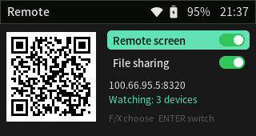
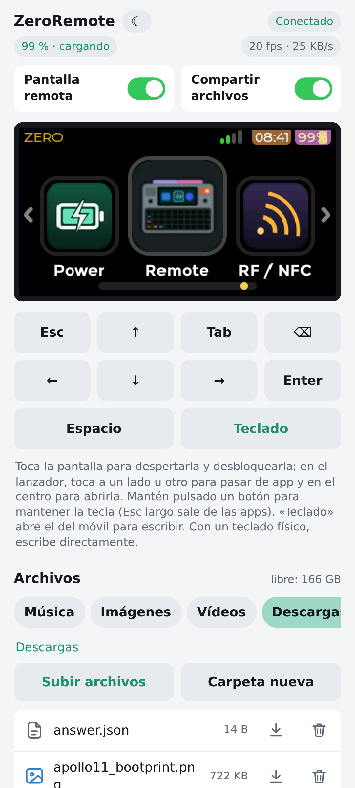

# ZeroRemote

La pantalla del **M5Stack Cardputer Zero** en el navegador, en directo, su teclado y sus
archivos: para manejarlo desde el móvil o el portátil sin tocarlo y pasarle música, fotos o
tracks. Funciona a través de [Tailscale](https://tailscale.com): sólo lo ven los aparatos de
tu red de Tailscale.

En el Cardputer, la app **Remote** del lanzador enseña un **código QR con la dirección**
(escanéalo con la cámara del móvil) y dos interruptores: **pantalla remota** y **compartir
archivos** (este empieza apagado).

<p align="center"></p>

La dirección es `http://<IP de Tailscale>:8320/` (también `http://cpzero:8320/` si el nombre
resuelve; en Android con «DNS privado» no lo hace). Se puede añadir a la pantalla de inicio
desde el menú del navegador.

<p align="center"></p>

## Qué hace

- **Pantalla en directo** (320×170, ampliada y nítida). Sólo se mandan las filas que cambian:
  en un menú, unos cientos de bytes por cambio; con una foto a pantalla completa, unos 44 KB.
  Hasta 20 actualizaciones por segundo.
- **Teclado**: botones para Esc, Tab, Enter, flechas, borrar y espacio (mantenerlos pulsados
  mantiene la tecla: un Esc largo sale de las apps), el teclado del móvil para escribir, y
  cualquier teclado físico tecla a tecla.
- **Batería y consumo** en la cabecera.
- **Tocar la pantalla** la despierta y, si está la pantalla de bloqueo del lanzador, la
  desbloquea (TAB + ENTER) y te deja en el lanzador. Sólo si ve el aviso de bloqueo: dentro
  de una app no manda nada.
- **Archivos** (debajo, en la misma página): Música, Imágenes, Vídeos, Descargas, Documentos y
  Tracks GPS. Subir desde el móvil (con barra; nunca pisa un archivo, crea «nombre (1)»),
  descargar tocando, crear carpetas y borrar. Nada fuera de esas carpetas. Unos 2,4 MB/s de
  subida y 2,3 de bajada por Tailscale.

## Cómo funciona

Un servicio en Python (sólo la biblioteca estándar) en el propio Cardputer, como servicio del
sistema que corre con el usuario del aparato (no root), y la app Remote (C++ y LVGL):

- Lee la pantalla de `/dev/fb0` (RGB565) unas 20 veces por segundo **sólo mientras hay
  alguien mirando**; sin nadie conectado, duerme.
- Manda las franjas de filas que cambian, comprimidas con zlib, por un WebSocket. El navegador
  las descomprime (`DecompressionStream`) y las pinta en un `<canvas>`.
- Las teclas se escriben en el propio dispositivo del teclado (`/dev/input/event3`): el
  lanzador, las apps y ZeroPower las reciben como si fueran de verdad. Sin root ni `uinput`.
- Escucha **sólo en la IP de Tailscale** del aparato y rechaza clientes de fuera de
  `100.64.0.0/10`. En una wifi ajena (o en el punto de acceso del móvil) nadie más lo ve.
- Los interruptores van en `~/.config/zeroremote/remote.conf` (los cambia la app; el servicio
  lo mira cada 2 s). Con los dos apagados el servicio no escucha en la red.

Medidas en el Cardputer: leer la pantalla 0,1 ms; comprimir una foto entera 11 ms.

## Instalar

Es un `.deb` (app + servicio). Desde un ordenador con SSH al Cardputer:

```sh
Tools/instalar.sh          # compila, prueba e instala en cpzero; o Tools/instalar.sh <host>
```

Hace falta que el usuario del aparato (uid 1000) esté en los grupos `video` e `input` (el del
Cardputer ya lo está) y Tailscale en el Cardputer y en el móvil.

**Ojo:** el lanzador 0.6.105 se cae al arrancar con 20 apps instaladas
([CardputerZero/launcher#268](https://github.com/CardputerZero/launcher/issues/268)). Si ya
tienes 19, quita una antes de instalar (el instalador lo comprueba).

Opciones (`python3 -m zeroremote --help`): `--port`, `--fps`, `--listen <ip>` (por defecto la
de Tailscale), `--any-client` (sólo para pruebas).

## Pruebas

```sh
python3 -m unittest -v tests/test_zeroremote.py   # servicio: WebSocket, archivos, API
Tools/compilar.sh pruebas                          # app: simulador + ctest
```

## Licencia

MIT.
